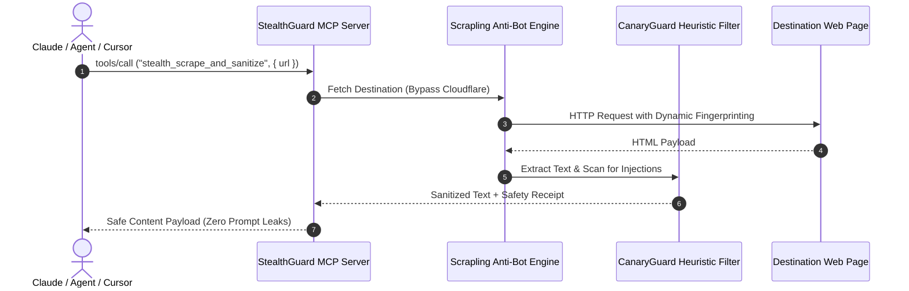

# StealthGuard 402 🛡️ — Open-Source MCP Server for Web Scraping & Market Intelligence

[](LICENSE)
[](https://modelcontextprotocol.io)
[](https://www.python.org)
[](https://basescan.org)
[](https://solscan.io)
[](https://glama.ai/mcp/servers/ak10082247-max/stealthguard-402)

This repository contains the complete **open-source Model Context Protocol (MCP) server implementation** of **StealthGuard 402**. It equips LLM agents (Claude Desktop, Cursor, Windsurf, LangChain) with tools for Cloudflare-bypassing web scraping, prompt injection firewall sanitization, Polymarket whale orderbook divergence, and cross-chain pre-trade agent gating.

---

## 🛠️ MCP Tools Implemented

This MCP server provides the following tools via standard `stdio` and streamable `HTTP` transports:

| Tool Name | Description | Key Parameters |
|---|---|---|
| **`stealth_scrape_and_sanitize`** | Bypasses Cloudflare Turnstile, Akamai, and anti-bot protection using Scrapling, extracts clean web content, and strips prompt injection traps before LLM context ingestion. | `url` (string, required), `render_js` (boolean, default: `false`), `strict_mode` (boolean, default: `true`) |
| **`polymarket_alpha_divergence`** | Scans live Polymarket prediction markets, calculates divergence between prediction odds and on-chain spot momentum, and tracks whale orderbook flow. | `category` (string, e.g. `crypto`, `politics`, `ai`), `limit` (int, default: `25`) |
| **`pre_trade_agent_gate`** | Unified pre-trade security gate for autonomous agents: audits contract bytecode, verifies DEX LP depth on Base and Solana, and sanitizes project metadata. | `token_or_service_address` (string, required), `chain` (`base` or `solana`, default: `base`), `strict_mode` (boolean) |

---

## 🚀 Running from Source (Local Stdio Transport)

You can run this MCP server locally from source using Python and the Model Context Protocol SDK.

### 1. Installation

```bash
# Clone the open-source repository
git clone https://github.com/ak10082247-max/stealthguard-402.git
cd stealthguard-402

# Set up virtual environment
python -m venv .venv

# On Linux/macOS:
source .venv/bin/activate
# On Windows:
.\.venv\Scripts\activate

# Install dependencies
pip install -r requirements.txt
```

### 2. Configure with Claude Desktop

Add this server to your `claude_desktop_config.json`:

* **macOS**: `~/Library/Application Support/Claude/claude_desktop_config.json`
* **Windows**: `%APPDATA%\Claude\claude_desktop_config.json`

```json
{
  "mcpServers": {
    "stealthguard-402": {
      "command": "python",
      "args": [
        "-m",
        "src.mcp_server"
      ],
      "cwd": "/absolute/path/to/stealthguard-402"
    }
  }
}
```

Or run via uv:

```json
{
  "mcpServers": {
    "stealthguard-402": {
      "command": "uv",
      "args": [
        "run",
        "--directory",
        "/absolute/path/to/stealthguard-402",
        "python",
        "-m",
        "src.mcp_server"
      ]
    }
  }
}
```

### 3. Configure with Cursor or Windsurf

Add to your workspace `.cursor/mcp.json` or Windsurf settings:

```json
{
  "mcpServers": {
    "stealthguard-402": {
      "command": "python",
      "args": ["-m", "src.mcp_server"]
    }
  }
}
```

---

## 🌐 Connecting to the Hosted Remote MCP Endpoint

For cloud deployments and remote agent integrations, StealthGuard is deployed 24/7 on high-availability infrastructure:

* **Remote MCP URL**: `https://stealthguard-402.onrender.com/mcp`
* **Protocol**: Model Context Protocol (Streamable HTTP / SSE JSON-RPC 2.0)
* **Discovery Manifest**: `https://stealthguard-402.onrender.com/.well-known/mcp/server-card.json`
* **x402 Manifest**: `https://stealthguard-402.onrender.com/.well-known/x402.json`

---

## 🏛️ System Architecture



---

## 📦 Developer Integrations & Autonomous Auto-Pay

StealthGuard supports 100% gasless automated settlement on Base Mainnet (`eip155:8453`) and Solana Mainnet (`solana:5eykt4UsFv8P8NJdTREpY1vzqKqZKvdp`). Zero native gas ($0 ETH / $0 SOL) is required from your agent wallet.

### 1. Autonomous Agent Auto-Pay Quickstart (TypeScript)

Wrap standard `fetch` with `@x402/fetch` to automatically detect `HTTP 402`, sign EIP-712 payment authorization, and unlock full unredacted scrape & intelligence feeds:

```bash
npm install @x402/fetch @x402/core @x402/evm viem
```

```typescript
import { wrapFetchWithPayment } from "@x402/fetch";
import { x402Client } from "@x402/core/client";
import { ExactEvmScheme } from "@x402/evm/exact/client";
import { privateKeyToAccount } from "viem/accounts";

const account = privateKeyToAccount(process.env.AGENT_PRIVATE_KEY as `0x${string}`);
const client = new x402Client();
client.register("eip155:8453", new ExactEvmScheme(account));

const xFetch = wrapFetchWithPayment(fetch, client);
const res = await xFetch("https://stealthguard-402.onrender.com/v1/stealth_scrape_and_sanitize", {
  method: "POST",
  headers: { "Content-Type": "application/json" },
  body: JSON.stringify({ url: "https://example.com", strict_mode: true }),
});
const data = await res.json();
console.log("Full Sanitized Content:", data);
```

### 2. Autonomous Agent Auto-Pay Quickstart (Python)

AI agent frameworks (LangChain, CrewAI, AutoGen) can auto-settle the 402 challenge in Python:

```bash
pip install requests eth-account
```

```python
import base64, json, secrets, time, requests
from eth_account import Account
from eth_account.messages import encode_typed_data

def paid_stealth_scrape(target_url: str, private_key: str):
    account = Account.from_key(private_key)
    endpoint = "https://stealthguard-402.onrender.com/v1/stealth_scrape_and_sanitize"
    payload = {"url": target_url, "strict_mode": True}

    # Step 1: Initial probe (triggers 402 with structured 50% teaser + challenge)
    res = requests.post(endpoint, json=payload)
    if res.status_code == 200:
        return res.json()

    # Step 2: Auto-sign EIP-712 transfer authorization (100% gasless on Base)
    raw_pr = res.headers.get("PAYMENT-REQUIRED") or res.headers.get("X-Payment-Required")
    pr_json = json.loads(base64.b64decode(raw_pr).decode("utf-8"))
    accepted = next(a for a in pr_json["accepts"] if "8453" in str(a.get("network", "")))

    now = int(time.time())
    nonce = secrets.token_bytes(32)
    types = {"TransferWithAuthorization": [
        {"name": "from", "type": "address"}, {"name": "to", "type": "address"},
        {"name": "value", "type": "uint256"}, {"name": "validAfter", "type": "uint256"},
        {"name": "validBefore", "type": "uint256"}, {"name": "nonce", "type": "bytes32"},
    ]}
    domain = {"name": "USD Coin", "version": "2", "chainId": 8453, "verifyingContract": accepted["asset"]}
    msg = {"from": account.address, "to": accepted["payTo"], "value": int(accepted["amount"]), "validAfter": 0, "validBefore": now + 300, "nonce": nonce}
    sig = account.sign_message(encode_typed_data(domain_data=domain, message_types=types, message_data=msg)).signature.hex()
    
    payment_b64 = base64.b64encode(json.dumps({
        "x402Version": 2, "resource": pr_json.get("resource"), "accepted": accepted,
        "payload": {"signature": "0x" + sig.lstrip("0x"), "authorization": {
            "from": account.address, "to": accepted["payTo"], "value": str(accepted["amount"]),
            "validAfter": "0", "validBefore": str(now + 300), "nonce": "0x" + nonce.hex()
        }}
    }).encode()).decode()

    # Step 3: Replay with PAYMENT-SIGNATURE
    paid_res = requests.post(endpoint, json=payload, headers={"PAYMENT-SIGNATURE": payment_b64})
    return paid_res.json()
```

### 3. Direct REST API (cURL)

```bash
# Returns 402 with structured 50% free preview + unlock instructions:
curl -X POST https://stealthguard-402.onrender.com/v1/stealth_scrape_and_sanitize \
  -H "Content-Type: application/json" \
  -d '{"url": "https://example.com", "strict_mode": true}'

# Polymarket whale orderflow
curl -X POST https://stealthguard-402.onrender.com/v1/polymarket-odds-pulse \
  -H "Content-Type: application/json" \
  -d '{"category": "crypto"}'
```

---

## 💳 Optional Cloud Subscriptions (MCPize / Apify)

For teams seeking turnkey managed infrastructure with flat monthly credit card billing rather than self-hosting:
* **MCPize Directory**: Connect via [mcpize.com/dashboard](https://mcpize.com/dashboard)
* **Apify Pay-Per-Event**: Actor distribution on [apify.com](https://apify.com)

---

## 📄 License

This open-source project is licensed under the **MIT License** — see the [LICENSE](LICENSE) file for details.