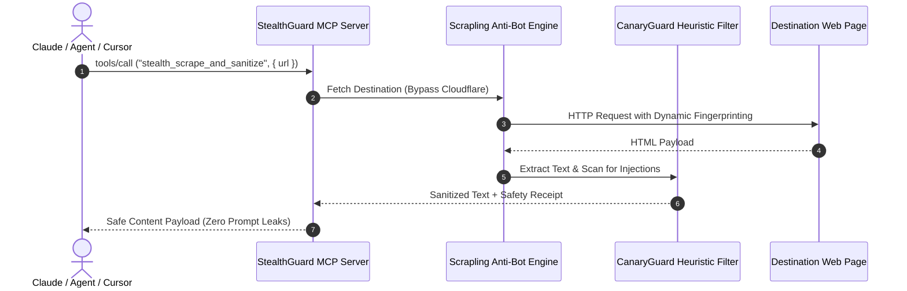

# StealthGuard 402 🛡️ — Open-Source MCP Server for Web Scraping & Market Intelligence

[](LICENSE)
[](https://modelcontextprotocol.io)
[](https://www.python.org)
[](https://basescan.org)
[](https://solscan.io)

This repository contains the complete **open-source Model Context Protocol (MCP) server implementation** of **StealthGuard 402**. It equips LLM agents (Claude Desktop, Cursor, Windsurf, LangChain) with tools for Cloudflare-bypassing web scraping, prompt injection firewall sanitization, Polymarket whale orderbook divergence, and cross-chain pre-trade agent gating.

---

## 🛠️ MCP Tools Implemented

This MCP server provides the following tools via standard `stdio` and streamable `HTTP` transports:

| Tool Name | Description | Key Parameters |
|---|---|---|
| **`stealth_scrape_and_sanitize`** | Bypasses Cloudflare Turnstile, Akamai, and anti-bot protection using Scrapling, extracts clean web content, and strips prompt injection traps before LLM context ingestion. | `url` (string, required), `render_js` (boolean, default: `false`), `strict_mode` (boolean, default: `true`) |
| **`polymarket_alpha_divergence`** | Scans live Polymarket prediction markets, calculates divergence between prediction odds and on-chain spot momentum, and tracks whale orderbook flow. | `category` (string, e.g. `crypto`, `politics`, `ai`), `limit` (int, default: `25`) |
| **`pre_trade_agent_gate`** | Unified pre-trade security gate for autonomous agents: audits contract bytecode, verifies DEX LP depth on Base and Solana, and sanitizes project metadata. | `token_or_service_address` (string, required), `chain` (`base` or `solana`, default: `base`), `strict_mode` (boolean) |

---

## 🚀 Running from Source (Local Stdio Transport)

You can run this MCP server locally from source using Python and the Model Context Protocol SDK.

### 1. Installation

```bash
# Clone the open-source repository
git clone https://github.com/ak10082247-max/stealthguard-402.git
cd stealthguard-402

# Set up virtual environment
python -m venv .venv

# On Linux/macOS:
source .venv/bin/activate
# On Windows:
.\.venv\Scripts\activate

# Install dependencies
pip install -r requirements.txt
```

### 2. Configure with Claude Desktop

Add this server to your `claude_desktop_config.json`:

* **macOS**: `~/Library/Application Support/Claude/claude_desktop_config.json`
* **Windows**: `%APPDATA%\Claude\claude_desktop_config.json`

```json
{
  "mcpServers": {
    "stealthguard-402": {
      "command": "python",
      "args": [
        "-m",
        "src.mcp_server"
      ],
      "cwd": "/absolute/path/to/stealthguard-402"
    }
  }
}
```

Or run via uv:

```json
{
  "mcpServers": {
    "stealthguard-402": {
      "command": "uv",
      "args": [
        "run",
        "--directory",
        "/absolute/path/to/stealthguard-402",
        "python",
        "-m",
        "src.mcp_server"
      ]
    }
  }
}
```

### 3. Configure with Cursor or Windsurf

Add to your workspace `.cursor/mcp.json` or Windsurf settings:

```json
{
  "mcpServers": {
    "stealthguard-402": {
      "command": "python",
      "args": ["-m", "src.mcp_server"]
    }
  }
}
```

---

## 🌐 Connecting to the Hosted Remote MCP Endpoint

For cloud deployments and remote agent integrations, StealthGuard is deployed 24/7 on high-availability infrastructure:

* **Remote MCP URL**: `https://stealthguard-402.onrender.com/mcp`
* **Protocol**: Model Context Protocol (Streamable HTTP / SSE JSON-RPC 2.0)
* **Discovery Manifest**: `https://stealthguard-402.onrender.com/.well-known/mcp/server-card.json`
* **x402 Manifest**: `https://stealthguard-402.onrender.com/.well-known/x402.json`

---

## 🏛️ System Architecture



---

## 📦 Developer Integrations

### Direct REST API (cURL)

```bash
# Stealth scrape & prompt-injection sanitize
curl -X POST https://stealthguard-402.onrender.com/v1/stealth_scrape_and_sanitize \
  -H "Content-Type: application/json" \
  -d '{"url": "https://example.com", "strict_mode": true}'

# Polymarket whale orderflow
curl -X POST https://stealthguard-402.onrender.com/v1/polymarket-odds-pulse \
  -H "Content-Type: application/json" \
  -d '{"category": "crypto"}'
```

### Python Quantitative Bot Integration

```python
import requests

def safe_scrape(target_url: str):
    res = requests.post(
        "https://stealthguard-402.onrender.com/v1/stealth_scrape_and_sanitize",
        json={"url": target_url, "strict_mode": True}
    )
    return res.json()
```

---

## 💳 Optional Cloud Subscriptions (MCPize / Apify)

For teams seeking turnkey managed infrastructure with flat monthly credit card billing rather than self-hosting:
* **MCPize Directory**: Connect via [mcpize.com/dashboard](https://mcpize.com/dashboard)
* **Apify Pay-Per-Event**: Actor distribution on [apify.com](https://apify.com)

---

## 📄 License

This open-source project is licensed under the **MIT License** — see the [LICENSE](LICENSE) file for details.